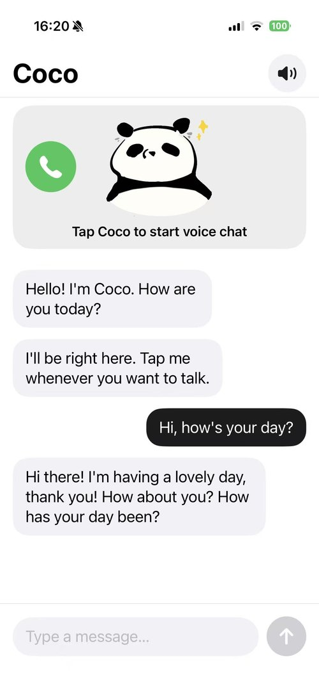
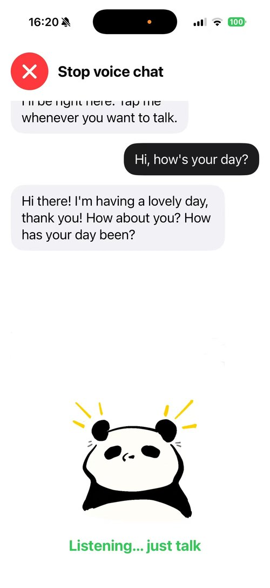
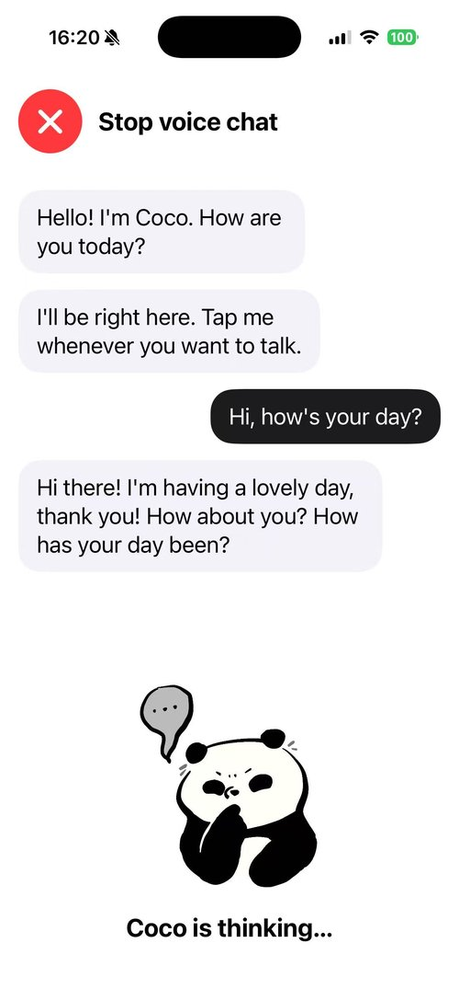
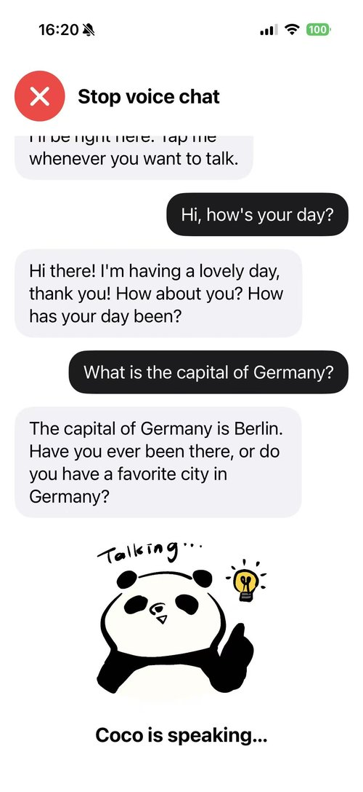
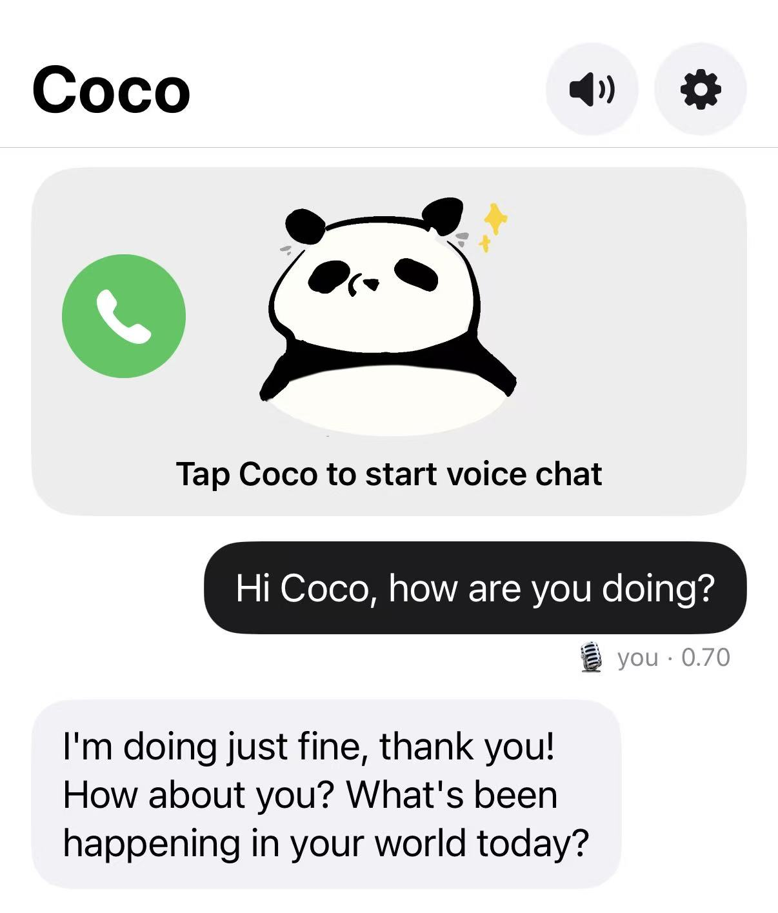
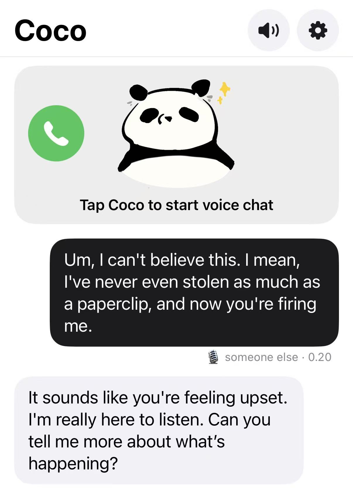
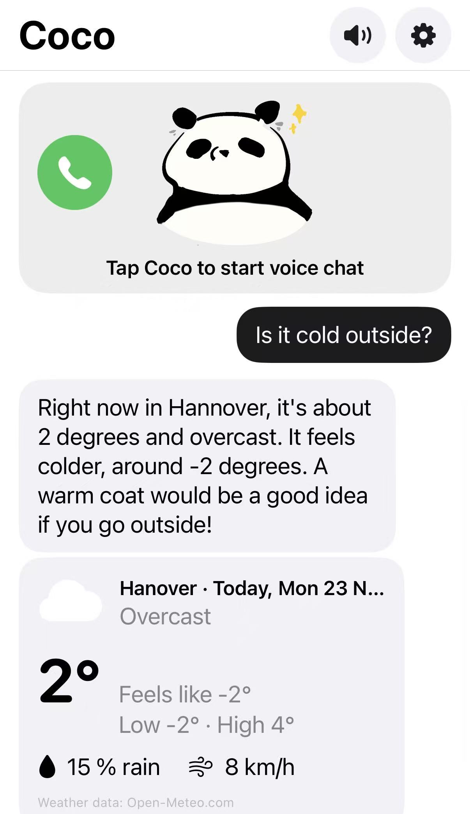

# Coco

**A digital everyday-assistance service for older adults, staffed by AI agents.**

Semester project for the course *Frontier Systems* (L3S, Leibniz Universität Hannover, winter 2026/27), theme "AI for Good".

## Meet Coco

Coco is a panda (hand-drawn). In the app, her picture shows what she's doing:

| Call Coco | Listening | Thinking | Talking |
|:---:|:---:|:---:|:---:|
|  |  |  |  |
| tap to start a voice chat | while you talk | while she works on an answer | while she answers out loud |

## Screenshots

The current prototype on an iPhone:

| Text chat | Voice: listening | Voice: thinking | Voice: talking |
|:---:|:---:|:---:|:---:|
|  |  |  |  |
| type, or tap the panda to talk | just talk, no button needed | Coco works on her answer | Coco answers out loud |

**Voice recognition:** Coco knows whether the person she looks after is talking, or someone else
(a visitor, the TV). The grey label under each voice message shows it (for testing):

| The user | Someone else (the TV) |
|:---:|:---:|
|  |  |
| recognised as the user (score 0.70) | a line from a TV show: someone else (0.20) |

**Weather:** ask about the weather and Coco checks the forecast; the app shows it as a card.
The town comes from Settings when you don't say where.



## Why

Many older adults live on their own and want to stay independent, but everyday life is full of small digital barriers:
scam messages, getting lost without a navigation app, forgotten appointments, medication, or a pot left on the stove.
Usually the only help is calling the family, and often no one is available.

Germany and China face the same trend:
- **Germany:** 31% of the population is aged 60+, and 10% of people aged 65–74 have never used the internet.
  Up to 690,000 care workers could be missing by 2049.
- **China:** 323 million people are aged 60+ (about 23%), expected to exceed 400 million by 2035.
  Only 53.7% of them use the internet, and about 60% live alone or only with a spouse.

In both countries, families and carers can't cover the growing need for everyday support.

Coco's idea: a team of AI agents that remembers each person's needs, routines and family can take over routine digital
and daily tasks, so older adults stay independent, safe from scams and less lonely, and scarce human time goes to the care
only humans can give.

## How it works

Coco is an iPhone app (Apple Watch later for reminders), set up once by the family and opened with one tap.

**Front office**: agents that talk to the older person, built one by one:
1. **Companion** with long-term memory
2. **Everyday tools**: weather ✅, reminders (medication, appointments, "the pot on the stove"), calendar, music, web search
3. **Voice**: hands-free voice chat ✅, and **voice recognition** ✅: Coco tells the user apart from visitors
   and the TV, and keeps the user's private things private
4. **Advanced helpers**: scam guard, email, family liaison, messaging, videos and maps (in versions for China and Germany)

**Back office**: agents that run the company: engineer, code review, QA, and later a scam analyst and support.

**Who pays:** older adults use Coco; their adult children pay for a family plan. No ads, no selling of data.

## Boundaries

- Users always know they are talking to an AI.
- Emergencies ("I fell") are passed to family or emergency services (112).
- Coco never enters passwords or makes payments.
- Health information is used only for reminders, never for medical advice.
- Conversations stay private. Coco doesn't tell visitors how the user is doing, or anything about
  their health, medication, appointments or family.

## Architecture

```
iPhone app (SwiftUI)  ⇄  Python back end (EU server)  ⇄  OpenAI API
                              └─ voice recognition (runs on our server)
```

The app stays thin. The API key and all agent logic live in the back end, which runs on an EU server
(Hetzner, Helsinki, GDPR). A Mac can run the same back end for development; the app switches between
the two in its settings.

**Where the data goes:**

| What | Where |
|---|---|
| Voice recording | OpenAI (speech → text) + our server (voice recognition) |
| Voice fingerprint (a list of numbers, never the audio) | only our server |
| Chat text, the user's name | OpenAI (Coco's replies) |
| Coco's spoken reply | made by OpenAI |

Voice recognition uses the open-source model [SpeechBrain ECAPA](https://huggingface.co/speechbrain/spkrec-ecapa-voxceleb),
running on our own server. No audio goes to a voice-recognition provider.

```
ios/          SwiftUI app
server/       Python back end (agent core, later tools, memory, evaluation)
docs/         proposal, feedback, slides, app-pictures (app screenshots)
```

## Status

🚧 Early development (prototype, English only).

Working now:
- **Chat with Coco** in the iPhone app, by text, with her personality and safety rules.
- **Hands-free voice chat:** tap the panda, just talk. Coco notices when you stop, answers out loud,
  then listens again (OpenAI speech-to-text and text-to-speech, through the back end).
- **Online:** the back end runs on an EU server with HTTPS and an app password, so Coco works anywhere,
  on Wi-Fi or mobile data.
- **Voice recognition:** the user records 3 sentences once (Settings → Voice fingerprint). After that,
  every voice message is checked: the user, or someone else? Coco answers everyone, but treats
  visitors differently (friendly, no private details) and notices when it's just the TV.
  Emergencies count from anyone.
- **Settings:** what Coco should call you, how she refers to you to others (she / he / they / just the name),
  and your town (for the weather when you don't say where).
- **First tool: the weather.** Ask "Will it rain tomorrow?" or "What should I wear?" and Coco checks the
  forecast (any town, today up to 6 days ahead). The app shows it as a weather card (picture, temperature,
  rain, wind) under her answer. If the weather service is down, she says so instead of guessing.

Coming next: see the development plan below.

## Development plan

| When | What |
|---|---|
| **by 15 Nov** | Basic question-answering agent: text and voice chat ✅ |
| **Nov** | Voice recognition (voiceprint) ✅ |
| **Nov – Dec** | Long-term memory (only saves what the real user said) + basic tools that work in both China and Germany: weather ✅, calendar, reminders, Apple Music, web search |
| **mid Dec + Christmas** | Evaluation: design and run **base** tasks (do the tools work?), **long-term memory** tasks (does memory work?) and **hallucination** tasks (does Coco admit what she can't do?). Improve the score using the conversation logs. |
| **January** | Advanced features: scam detection, email, family liaison, and country-specific pairs (WeChat / WhatsApp, Bilibili / YouTube, Baidu Maps / Google Maps). Then their tasks, and improve the score again. |

**Evaluation** is adapted from [CAR-bench](https://arxiv.org/abs/2601.22027): a simulated older user (LLM with a persona)
talks to Coco, an evaluator checks the conversation (rule-based + LLM-as-judge), and every task runs 3 times
(Pass^3 = reliable, Pass@3 = solvable). The first run is the baseline.

## Credits

Weather data by [Open-Meteo.com](https://open-meteo.com/) (CC BY 4.0).
