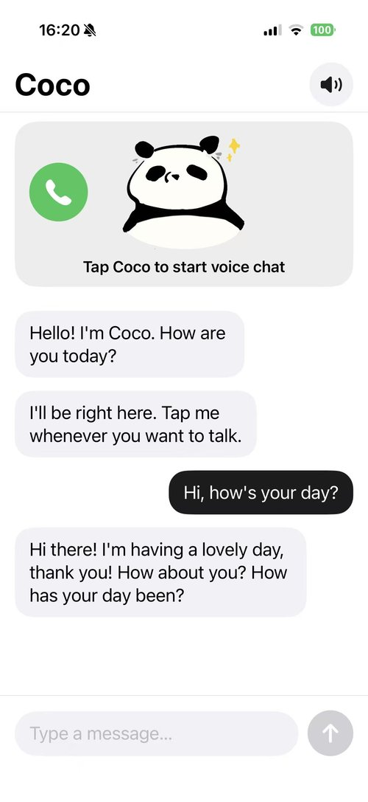
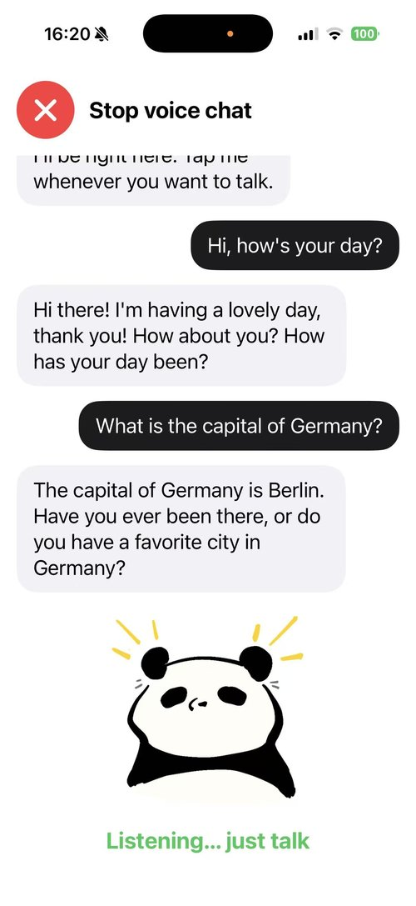
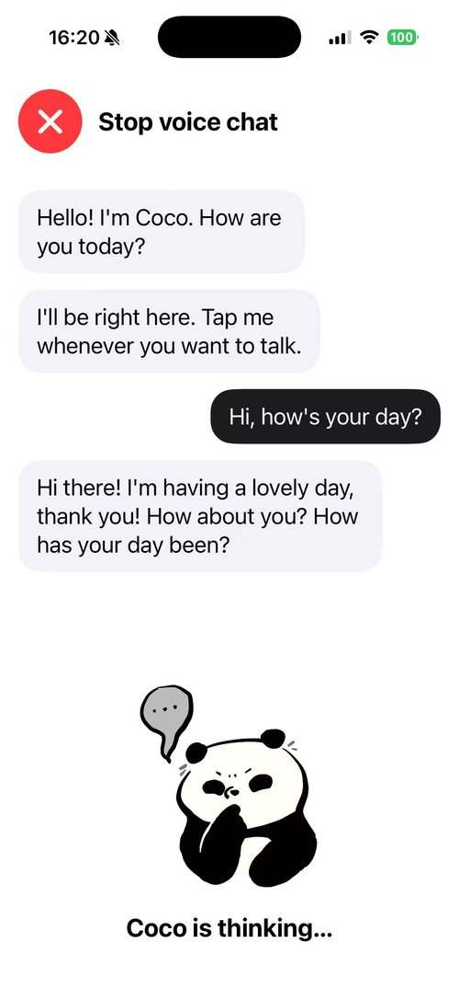
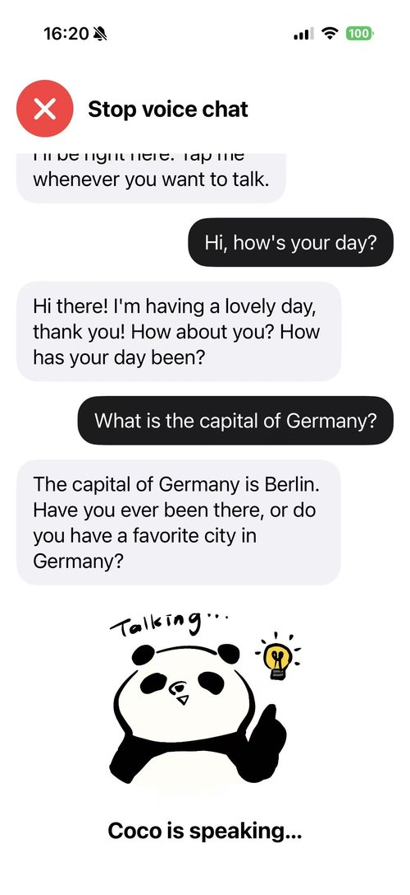

# Coco

**A digital everyday-assistance service for older adults, staffed by AI agents.**

Semester project for the course *Frontier Systems* (L3S, Leibniz Universität Hannover, winter 2026/27), theme "AI for Good".

## Meet Coco

Coco is a panda (hand-drawn). In the app, her picture shows what she's doing:

| Call Coco | Listening | Thinking | Talking |
|:---:|:---:|:---:|:---:|
|  |  |  |  |
| tap to start a voice chat | while you talk | while she works on an answer | while she answers out loud |

## Screenshots

The current prototype on an iPhone:

| Text chat | Voice: listening | Voice: thinking | Voice: talking |
|:---:|:---:|:---:|:---:|
|  |  |  |  |
| type, or tap the panda to talk | just talk, no button needed | Coco works on her answer | Coco answers out loud |

## Why

Many older adults live on their own and want to stay independent, but everyday life is full of small digital barriers:
scam messages, getting lost without a navigation app, forgotten appointments, medication, or a pot left on the stove.
Usually the only help is calling the family, and often no one is available.

Germany and China face the same trend:
- **Germany:** 31% of the population is aged 60+, and 10% of people aged 65–74 have never used the internet.
  Up to 690,000 care workers could be missing by 2049.
- **China:** 323 million people are aged 60+ (about 23%), expected to exceed 400 million by 2035.
  Only 53.7% of them use the internet, and about 60% live alone or only with a spouse.

In both countries, families and carers can't cover the growing need for everyday support.

Coco's idea: a team of AI agents that remembers each person's needs, routines and family can take over routine digital
and daily tasks, so older adults stay independent, safe from scams and less lonely, and scarce human time goes to the care
only humans can give.

## How it works

Coco is an iPhone app (Apple Watch later for reminders), set up once by the family and opened with one tap.

**Front office**: agents that talk to the older person, built one by one:
1. **Companion** with long-term memory
2. **Reminder assistant** for medication, appointments and short-term things ("the pot on the stove")
3. **Scam guard**
4. **Info helper** with plain-language answers and sources
5. **Video helper** for YouTube and saved links
6. **Voice version**

**Back office**: agents that run the company: engineer, code review, QA, and later a scam analyst and support.

**Who pays:** older adults use Coco; their adult children pay for a family plan. No ads, no selling of data.

## Boundaries

- Users always know they are talking to an AI.
- Emergencies ("I fell") are passed to family or emergency services (112).
- Coco never enters passwords or makes payments.
- Health information is used only for reminders, never for medical advice.
- Conversations stay private.

## Architecture

```
iPhone app (SwiftUI)  ⇄  Python back end  ⇄  LLM API
```

The app stays thin. The API key and all agent logic live in the back end, which will later move to an EU-hosted server (GDPR).

```
ios/          SwiftUI app
server/       Python back end (agent core, later tools, memory, evaluation)
screenshots/  pictures of the app for this README
```

## Status

🚧 Early development (prototype, English only).

Working now:
- **Chat with Coco** in the iPhone app, by text, with her personality and safety rules.
- **Hands-free voice chat:** tap the panda, just talk. Coco notices when you stop, answers out loud,
  then listens again (OpenAI speech-to-text and text-to-speech, through the back end).

Coming next: long-term memory, reminders, scam check, and evaluation against a no-memory baseline in a simulated
environment (simulated older users + LLM evaluator).
